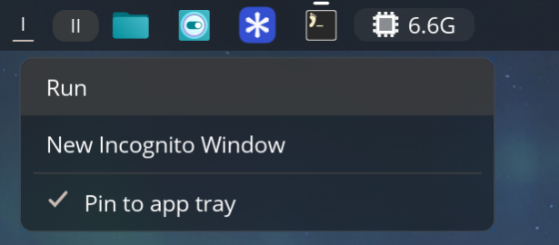

# niri-cosmic-applets

COSMIC panel applets for the [niri](https://github.com/YaLTeR/niri) compositor.
They use niri's IPC instead of COSMIC's Wayland protocols, so they work on a
COSMIC panel running under niri.

| Applet | Crate | Purpose |
|---|---|---|
| Input sources | `applets/input-sources` | Keyboard layout switcher driven by niri |
| Workspaces | `applets/workspaces` | Workspace list from niri |
| App tray | `applets/app-tray` | Running app list (based on COSMIC's `cosmic-app-list`) |

> The app tray uses the same desktop ID as the stock COSMIC app list
> (`com.system76.CosmicAppList`), so installing it replaces the stock applet.

## Install

Needs Rust, `pkg-config`, and `clang`/`libclang` (for bindgen).

    git clone https://github.com/elweday1/niri-cosmic-applets.git
    cd niri-cosmic-applets
    cargo build --release
    cp target/release/{app-tray-niri,workspaces-niri,cosmic-applet-input-sources} ~/.local/bin/
    cp data/*.desktop ~/.local/share/applications/

The binary and desktop IDs match the existing applets, so this replaces them.
Log out and back in to load the new builds.

## Develop

    cargo build --release
    cargo test

Upstream of these crates: [pop-os/cosmic-applets](https://github.com/pop-os/cosmic-applets)
(GPL-3.0-only). See `LICENSE`.
